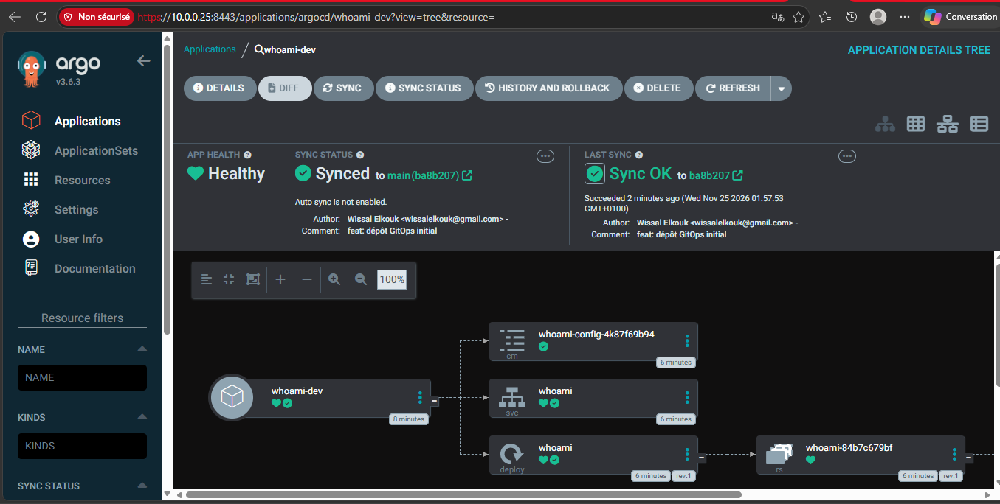
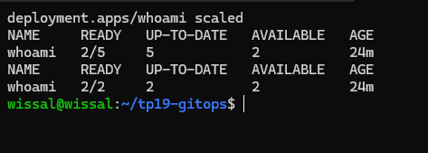
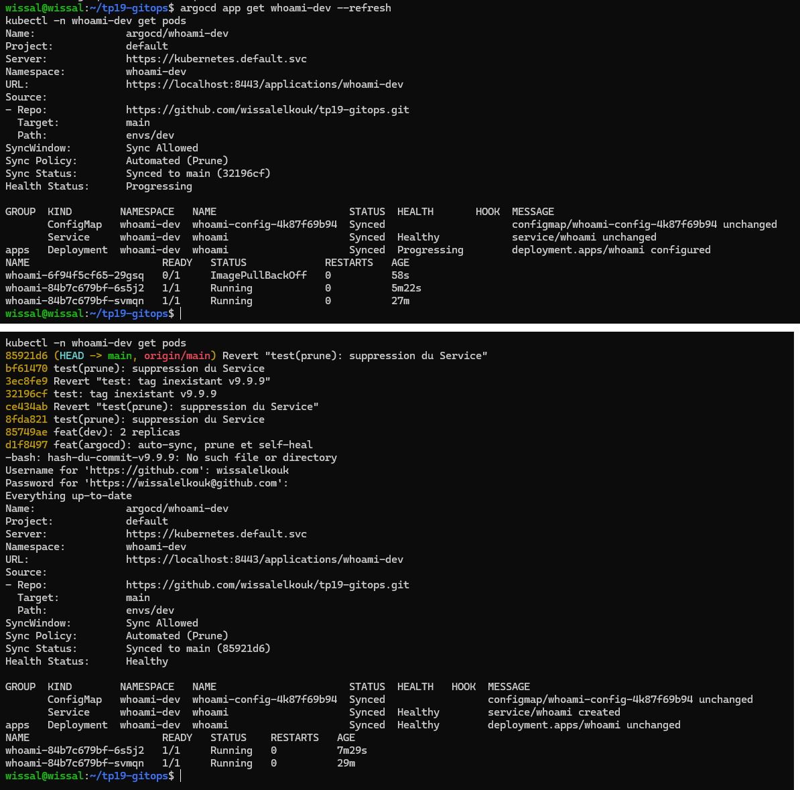
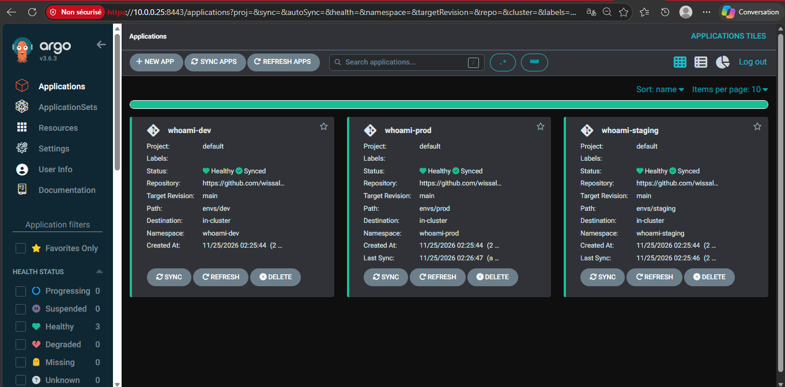
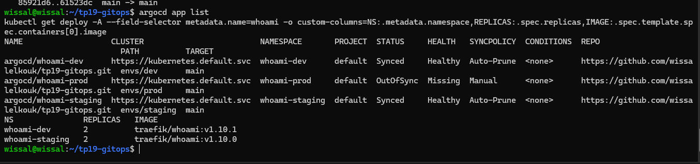
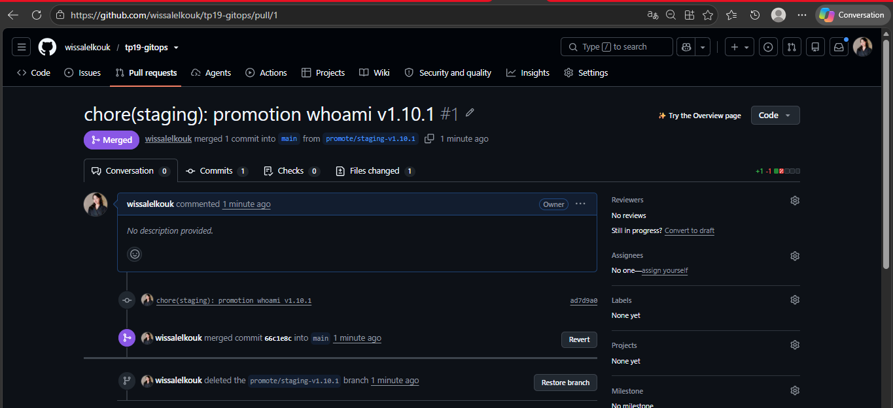
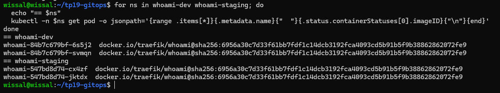
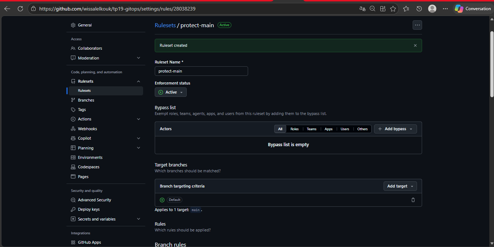
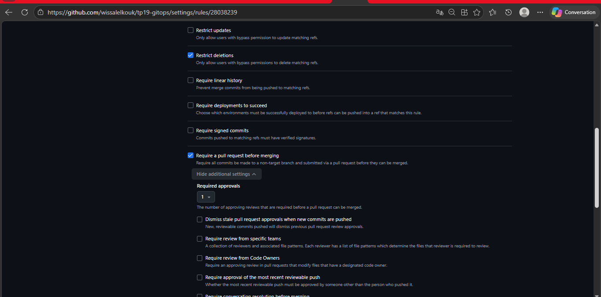
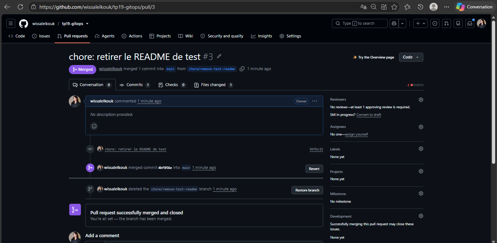

# TP19 : GitOps avec Argo CD

**Auteure :** Wissal Elkouk
**Dépôt :** https://github.com/wissalelkouk/tp19-gitops
**Outils :** K3s (v1.37.2), Argo CD v3.6.3, Kustomize, application de démo `traefik/whoami`

Ce dépôt est la source de vérité de l'état désiré du cluster. Argo CD compare en permanence Git et le cluster, puis les réconcilie. On ne fait plus de `kubectl apply` à la main : chaque changement passe par un commit ou une Pull Request.

---

## 1. Structure du dépôt

```
tp19-gitops/
├── argocd/
│   ├── application-dev.yaml     # Application unique (partie 2 et 3)
│   └── applicationset.yaml      # Une Application par environnement (partie 4)
├── base/                        # Deployment, Service, ConfigMap communs
├── envs/
│   ├── dev/                     # 2 replicas, whoami:v1.10.1
│   ├── staging/                 # promu de v1.10.0 vers v1.10.1 par PR
│   └── prod/                    # synchronisation manuelle
└── captures/                    # preuves du TP
```

Les quatre principes OpenGitOps sont respectés : état **déclaratif** (YAML/Kustomize), **versionné** (Git), **tiré** (Argo CD lit GitHub, aucun port entrant vers la VM) et **réconcilié en continu**.

---

## 2. Partie 1 : installation d'Argo CD

```bash
kubectl create namespace argocd
kubectl apply -n argocd --server-side -f https://raw.githubusercontent.com/argoproj/argo-cd/stable/manifests/install.yaml
kubectl -n argocd rollout status deploy/argocd-server
kubectl -n argocd get secret argocd-initial-admin-secret -o jsonpath='{.data.password}' | base64 -d; echo
kubectl -n argocd port-forward svc/argocd-server 8443:443 --address 0.0.0.0 &
argocd login localhost:8443 --insecure
```

### Incident rencontré : disque plein

Les pods Argo CD sont restés bloqués en `ContainerCreating`, `Pending` puis `ContainerStatusUnknown`. Le diagnostic a montré :

- le disque racine était à **99 %** (120 Mo libres) ;
- le kubelet avait posé le taint `node.kubernetes.io/disk-pressure:NoSchedule` sur le nœud, d'où les pods `Pending` (`untolerated taint`) ;
- les téléchargements d'images échouaient ou se figeaient.

Résolution : libération d'espace (suppression de fichiers de TP inutiles, nettoyage des journaux, du cache apt et des anciennes images), volume passé à 18 Go (45 %), puis `sudo systemctl restart k3s` pour que le kubelet réévalue la condition et retire le taint. L'image `quay.io/argoproj/argocd:v3.6.3` a ensuite été tirée une seule fois avec `crictl pull`.

---

## 3. Partie 2 : première Application (synchronisation manuelle)

```bash
kubectl apply -f argocd/application-dev.yaml
argocd app get whoami-dev      # OutOfSync / Missing
argocd app diff whoami-dev     # ConfigMap, Service, Deployment à créer
argocd app sync whoami-dev
kubectl -n whoami-dev get all
```

Avant la synchronisation, l'Application est `OutOfSync` et `Missing` : Git décrit des ressources qui n'existent pas encore dans le cluster. Après `sync`, elle passe à `Synced` et `Healthy`.

**Capture : Application `whoami-dev` Synced / Healthy**



---

## 4. Partie 3 : auto-sync, prune, self-heal et rollback

Bloc ajouté dans `argocd/application-dev.yaml` :

```yaml
syncPolicy:
  automated:
    prune: true
    selfHeal: true
  syncOptions:
    - CreateNamespace=true
```

### 4.1 Changement par Git

`count: 1` passé à `count: 2` dans `envs/dev/kustomization.yaml`, commit `feat(dev): 2 replicas`, push. Argo CD détecte le commit (`OutOfSync from main`) et applique le changement tout seul : 2 pods apparaissent sans aucune commande `argocd app sync`.

### 4.2 Dérive et self-healing

```bash
kubectl -n whoami-dev scale deploy whoami --replicas=5
```

Les 3 pods en trop sont créés, puis supprimés environ 8 secondes plus tard : Argo CD annule la modification manuelle et ramène le Deployment à 2 replicas (`READY 2/5` puis `2/2`).

**Capture : `kubectl scale` annulé par Argo CD**



### 4.3 Prune

`service.yaml` supprimé de `base/` **et** de la liste `resources` de `base/kustomization.yaml`, puis push : le Service `whoami` disparaît du cluster (`No resources found`). Un `git revert` du commit le recrée (`service/whoami created`).

### 4.4 Rollback par Git

Un tag d'image inexistant (`v9.9.9`) est poussé. Le nouveau pod passe en `ImagePullBackOff` et l'application reste `Progressing` (état de santé non sain), tandis que les 2 anciens pods continuent de servir grâce au rolling update. La correction se fait dans Git :

```bash
git revert HEAD --no-edit
git push
```

L'application redevient `Synced` / `Healthy`.

**Capture : application en erreur puis rétablie après `git revert`**



Historique des commits correspondant :

```
85921d6 Revert "test(prune): suppression du Service"
bf61470 test(prune): suppression du Service
3ec8fe9 Revert "test: tag inexistant v9.9.9"
32196cf test: tag inexistant v9.9.9
ce434ab Revert "test(prune): suppression du Service"
8fda821 test(prune): suppression du Service
85749ae feat(dev): 2 replicas
d1f8497 feat(argocd): auto-sync, prune et self-heal
```

> **Pourquoi pas de rollback par l'interface (History and rollback) ?** Tant que `automated` est actif, Argo CD remettrait aussitôt l'état de Git. En GitOps, on corrige dans Git.

---

## 5. Partie 4 : ApplicationSet et environnements

L'Application manuelle a été supprimée avec `argocd app delete whoami-dev --cascade=false` (les ressources sont conservées), puis l'ApplicationSet appliqué. Un générateur `git` en mode `directories` (`envs/*`) crée une Application par dossier : `whoami-dev`, `whoami-staging`, `whoami-prod`, chacune dans son namespace.

### Quels environnements en synchronisation automatique ?

Dev et staging sont synchronisés automatiquement, la **prod reste en synchronisation manuelle**. Cela s'exprime avec un `templatePatch` conditionnel :

```yaml
templatePatch: |
  {{- if ne .path.basename "prod" }}
  spec:
    syncPolicy:
      automated:
        prune: true
        selfHeal: true
  {{- end }}
```

Alternative : un générateur `list` avec un paramètre par environnement (par exemple `autoSync: true/false`).

Résultat observé :

| Application | Politique | État initial |
|---|---|---|
| `whoami-dev` | Auto-Prune | Synced / Healthy |
| `whoami-staging` | Auto-Prune | Synced / Healthy (v1.10.0) |
| `whoami-prod` | Manual | OutOfSync / Missing, puis synchronisée à la main |

**Capture : trois Applications générées par l'ApplicationSet**



Vue en ligne de commande (`argocd app list` et versions déployées par namespace) :



---

## 6. Partie 5 : promotion sans reconstruction

La version déployée dans chaque environnement est la ligne `newTag` de `envs/<env>/kustomization.yaml`. Promouvoir revient à copier ce tag d'un environnement vers le suivant, par Pull Request.

### Dev vers staging

```bash
git switch -c promote/staging-v1.10.1
sed -i 's/newTag: v1.10.0/newTag: v1.10.1/' envs/staging/kustomization.yaml
git commit -am "chore(staging): promotion whoami v1.10.1"
git push -u origin HEAD
```

La PR est relue puis mergée. Staging passe à `OutOfSync from main`, et Argo CD applique la nouvelle version automatiquement.

**Capture : Pull Request de promotion vers staging**



### Même image, sans reconstruction

Les digests des pods de dev et de staging sont identiques :

```
sha256:6956a30c7d33f61bb7fdf1c14dcb3192fca4093cd5b91b5f9b38862862072fe9
```

La promotion déplace donc exactement le même artefact d'un environnement à l'autre : rien n'est reconstruit.

**Capture : même digest en dev et en staging**



### Staging vers prod

Même procédure par PR. La prod n'étant pas en synchronisation automatique, elle reste `OutOfSync` après le merge jusqu'à l'exécution de `argocd app sync whoami-prod`. C'est un point de contrôle volontaire avant la production.

---

## 7. Protection de la branche `main`

Un ruleset GitHub `protect-main` (Enforcement : Active) cible la branche par défaut avec :

- **Require a pull request before merging**, **1 approbation** requise ;
- **Restrict deletions**.

Le rôle *Repository admin* est dans la bypass list, car je suis seule sur le dépôt et ne peux pas approuver ma propre PR. Un push direct de test a bien été signalé par GitHub : `Bypassed rule violations ... Changes must be made through a pull request`. La règle est donc active ; sans bypass, le push aurait été refusé.

**Captures du ruleset**





Message GitHub lors d'un push direct de test sur `main` (accepté uniquement grâce au bypass admin) :

```
remote: Bypassed rule violations for refs/heads/main:
remote: - Changes must be made through a pull request.
```

Le README de test ainsi poussé a ensuite été retiré par une Pull Request, conformément au workflow :



### Pourquoi la revue de la PR devient-elle la revue du changement en production ?

Argo CD déploie ce qui se trouve sur `main` : automatiquement pour dev et staging, après un `sync` pour la prod. Le merge d'une PR est donc l'acte de déploiement. Relire la PR revient à relire exactement le changement qui ira en production, avec un historique tracé (qui, quand, pourquoi) et un retour arrière possible par `git revert`. La protection de `main` garantit qu'aucun changement n'arrive en production sans cette revue.

---

## 8. Livrables

| Fichier | Contenu |
|---|---|
| `captures/argocd-synced.png` | `whoami-dev` Synced / Healthy |
| `captures/self-heal.png` | `kubectl scale` annulé par Argo CD |
| `captures/git-revert.png` | Application en erreur puis rétablie après `git revert` |
| `captures/applicationset.png` | Trois Applications générées |
| `captures/promotion-pr.png` | Pull Request de promotion vers staging |
| `captures/same-digest.png` | Même digest en dev et en staging |
| `captures/ruleset-active.png`, `ruleset-rules.png`, `pr-remove-readme.png` | Protection de `main` (bonus) |
| `captures/applicationset-cli.png` | `argocd app list` et versions par namespace (bonus) |

---

## 9. Bilan

- Git est la seule voie de changement : un `kubectl scale` manuel est annulé, un mauvais tag est corrigé par `git revert`.
- Un ApplicationSet évite de dupliquer les Applications et applique une politique différente selon l'environnement.
- La promotion par PR déplace la même image d'un environnement à l'autre, avec relecture à chaque étape.
- Difficultés : disque saturé et `disk-pressure` sur le nœud, indentation YAML (`syncPolicy`), commandes `git revert` à cibler sur le bon commit quand plusieurs tests s'enchaînent.
